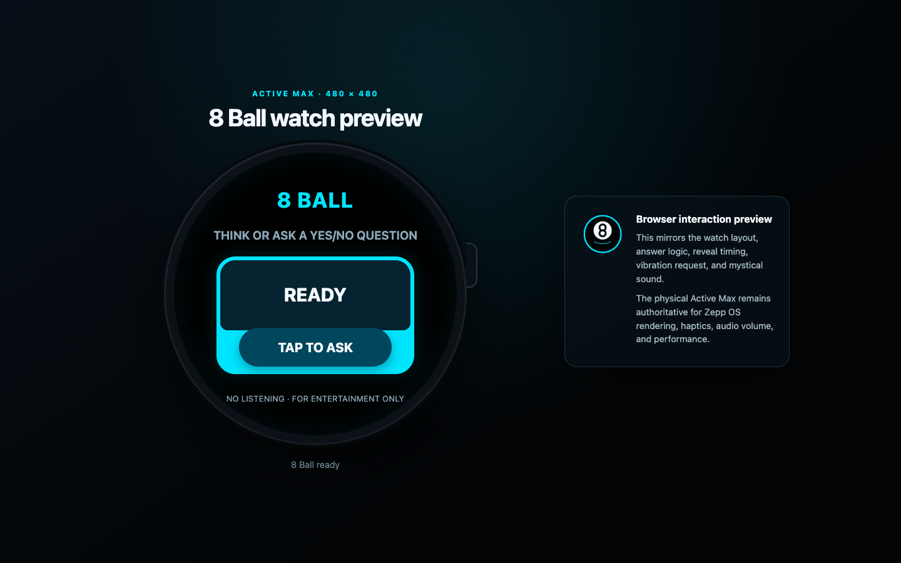
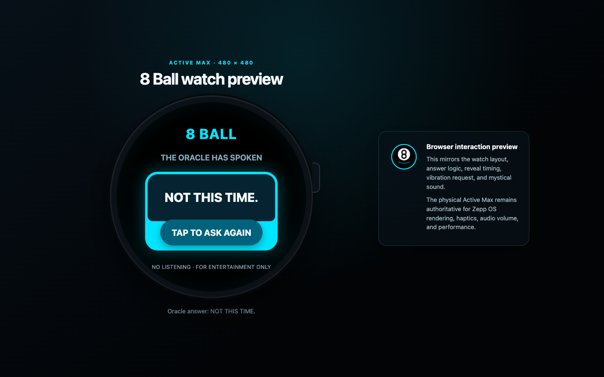

# 8 Ball for Amazfit Active Max

An offline, tap-first Zepp OS Mini Program—and an end-to-end experiment in building, testing, previewing, packaging, and delivering an original app to a physical Amazfit Active Max.

Built as a reusable foundation for future watch-app development: one shared answer engine powers the native watch experience and a browser interaction preview, while automated tests and GitHub Actions verify each change before device testing.

**Live browser preview:** [Open 8 Ball](https://alexgeslani.github.io/8-Ball/)

## Screenshots

| Ready to ask | Answer revealed |
|---|---|
|  |  |

## Highlights

- Native Zepp OS Mini Program for the **Amazfit Active Max** (`genevaw`, 480×480)
- 20 original local answers with no immediate repetition
- Short suspense phase before each reveal
- Native vibration request and an original local mystical sound
- Browser interaction preview using the same answer logic as the watch
- Deterministic Node test suite and Zeus package build in GitHub Actions
- Offline by design: no network requests, microphone, accounts, ads, analytics, or history

## End-to-end delivery experiment

This project exercises the complete development path needed for future Zepp OS apps:

```text
shared application logic
        ↓
native watch UI + browser interaction preview
        ↓
automated tests and Zeus package build
        ↓
Zeus preview QR on the paired phone
        ↓
physical Amazfit Active Max acceptance
        ↓
dev → pull request → main → tagged .zab release
```

The browser preview provides fast visual and interaction feedback, but it is deliberately not presented as a Zepp OS runtime emulator. Physical-watch testing remains authoritative for native rendering, touch geometry, haptics, sound volume, lifecycle behavior, and performance.

## Interaction

1. Think of or ask a yes-or-no question.
2. Tap **TAP TO ASK**.
3. Wait through the short consultation phase.
4. Read the answer, then tap again.

## Development

### Prerequisites

- Node.js 20
- Zepp OS Zeus CLI 1.9.3

### Verify and build

```bash
npm run build:web
npm test
zeus build
```

The generated browser artifact is written to `public/` and can be served by any static web server. Authenticated `zeus preview` QR generation stays local because preview sessions expire and require the developer's Zepp account.

## Project structure

```text
app.json                 Zepp OS manifest and Active Max targets
app.js                   application lifecycle
page/genevaw/            native 480×480 watch interface
assets/genevaw.r/        app icon and reveal sound
core/                    shared oracle behavior
web/                     browser-preview source
public/                  generated static preview artifact
test/                    behavior and contract tests
scripts/build-web.mjs     deterministic browser build
.github/workflows/       CI and tagged-release automation
```

## Release model

- `dev` is the integration branch used for iterative preview and watch candidates.
- `main` contains accepted, release-ready source.
- Version tags build a `.zab` package and SHA-256 checksum manifest.
- Expiring Zeus preview QR codes are intentionally not committed or published as releases.

## Current status

Version `0.2.0` targets Zepp OS 5.0 / API level 4.2 on the Amazfit Active Max. Automated oracle, package-contract, and browser-interaction tests are passing; native watch behavior remains subject to the physical-device acceptance gate described above.
